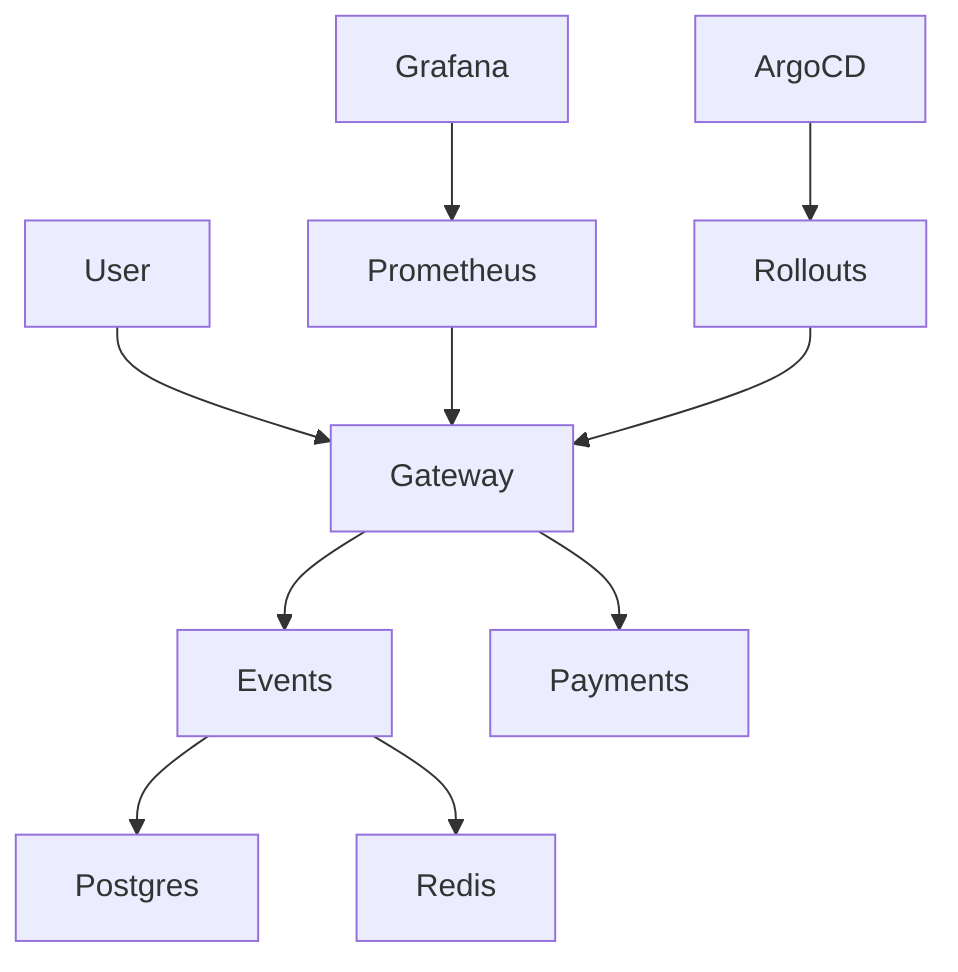

# QuickTicket SRE Handbook

## Architecture



- Gateway is an Argo Rollouts Canary and routes requests to Events and Payments.
- Events stores records in Postgres and reservation holds in Redis.
- Prometheus scrapes Gateway metrics; Grafana displays dashboards and alerts.
- ArgoCD applies Git changes; Argo Rollouts manages Gateway canary steps and analysis.

## How to deploy

1. Create a feature branch and make the manifest or application change.
2. Push the branch and open a PR. CI builds and publishes immutable image tags.
3. Merge the PR. ArgoCD syncs the updated desired state to the cluster.
4. Watch the rollout:

   ```bash
   kubectl argo rollouts get rollout gateway --watch
   kubectl argo rollouts status gateway --timeout=600s
   ```

5. Verify pods, endpoints, and health:

   ```bash
   kubectl get pods -o wide
   kubectl get endpointslice
   kubectl argo rollouts get rollout gateway
   ```

## Monitoring

- Check the QuickTicket golden-signals dashboard in Grafana for request rate, errors, and latency.
- Prometheus 5xx ratio:

  ```promql
  (sum(rate(gateway_requests_total{status=~"5.."}[5m])) or vector(0))
    / sum(rate(gateway_requests_total[5m]))
  ```

- Gateway p99 by path:

  ```promql
  histogram_quantile(
    0.99,
    sum by (le, path) (rate(gateway_request_duration_seconds_bucket[5m]))
  )
  ```

- During load, check CPU, memory, readiness, and restarts with `kubectl top pods` and `kubectl get pods -o wide`.

## Incident response

1. Confirm impact using the Gateway 5xx ratio, p99 latency, and `/health`.
2. Check Gateway Rollout status, pod readiness, restarts, and Events/Payments logs.
3. Check dependencies: Events uses Postgres and Redis; Gateway calls Events and Payments.
4. If a canary is failing, inspect its AnalysisRun and abort the rollout:

   ```bash
   kubectl argo rollouts get rollout gateway
   kubectl argo rollouts abort gateway
   kubectl argo rollouts status gateway --timeout=180s
   ```

5. Verify stable pods serve traffic, health returns HTTP 200, and the 5xx rate falls.
6. Record impact, timestamps, cause, recovery actions, and follow-up work.

## Backup and restore

Postgres uses the `postgres-data` PVC. The `postgres-backup` CronJob writes dumps to the `postgres-backups` PVC and keeps the five newest.

List backups and identify the pods:

```bash
kubectl exec deployment/backup-inspector -- ls -lt /backups
backup_inspector=$(kubectl get pod -l app=backup-inspector -o jsonpath='{.items[0].metadata.name}')
postgres_pod=$(kubectl get pod -l app=postgres -o jsonpath='{.items[0].metadata.name}')
```

Pause writers, then copy and restore the selected dump:

```bash
kubectl cp "$backup_inspector":/backups/quickticket_<UTC-timestamp>.dump /tmp/quickticket-restore.dump
kubectl cp /tmp/quickticket-restore.dump "$postgres_pod":/tmp/restore.dump
kubectl exec "$postgres_pod" -- pg_restore -U quickticket -d quickticket --clean --if-exists /tmp/restore.dump
```

Restart Events if its database connections are stale. Verify table counts, `/health`, and `GET /events` before resuming traffic. Record the backup timestamp and data-loss window.
